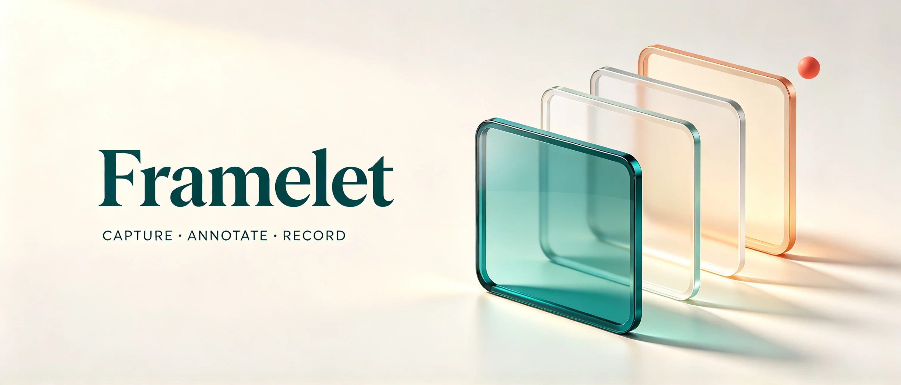

<p align="center"><a href="README.md">简体中文</a> · <strong>English</strong></p>



<h1 align="center">Framelet</h1>
<p align="center">Keep the part that matters.<br>A small Windows tool for screenshots, annotations, and screen recordings.</p>

<p align="center">
  <a href="https://github.com/chenzhiyong1994/Framelet/releases/latest"></a>
  
  <a href="LICENSE"></a>
</p>

<p align="center">
  <a href="https://github.com/chenzhiyong1994/Framelet/releases/latest"><strong>Download for Windows ↗</strong></a>
  &nbsp; · &nbsp; <a href="https://chenzhiyong1994.github.io/Framelet/en.html">Explore the website</a>
  &nbsp; · &nbsp; <a href="docs/usage.md">User guide (中文)</a>
</p>

## A clear picture. A clearer explanation.

Capture the part you need, mark what matters, or record a short walkthrough. Framelet keeps these everyday tasks in a compact toolbar that folds away at the edge of your screen.

| Capture | Annotate | Record |
| :--- | :--- | :--- |
| Drag a region or point to a window or monitor. Check your target before capturing. | Add arrows, text, numbered steps, highlights, or pixelation. Drag any image edge or corner to crop, with undo. | Choose an area and start after a countdown. A visible boundary, timer, and control bar show the recording state. |

**Unzip and run. Silent recording needs no setup.** The portable package includes the .NET runtime and uses Windows media services to create H.264 MP4 files. Audio capture and video trimming are optional extensions that require FFmpeg.

## New in v0.6.0

- **Choose the right target.** Point to a full window or individual monitor. Screen recording also supports monitor selection. Use `Tab` to switch monitors and `Esc` to cancel.
- **Crop from any edge.** Drag an edge or corner, preview the retained area, and release to crop. Press `Ctrl+Z` to undo.
- **See what is recording.** A red boundary indicates recording; yellow indicates pause. The label also shows the state and capture dimensions.
- **Leave without saving.** Finish or close the recorder to choose Save, Discard, or Return. Unwanted recordings can be discarded without choosing a file location.

## Get started

1. Download `Framelet-v0.6.0-win-x64.zip` from [Releases](https://github.com/chenzhiyong1994/Framelet/releases/latest).
2. Extract it to a local folder and open `Framelet.exe`. No installer needed.
3. Press `Ctrl+PrtSc` to select a region, or use the recording icon on the toolbar.

Screenshots open at **100% actual size**. Scroll larger images or switch to Fit to Window. The application UI is currently in Chinese; the README and website are available in Chinese and English.

## Everyday shortcuts

| Action | Shortcut |
| :--- | :--- |
| Select a region | `Ctrl+PrtSc` |
| Pick a full window / monitor | `Alt+PrtSc` / `PrtSc` |
| Show the toolbar | `Ctrl+Shift+F12` |
| Open the recorder | `Ctrl+Shift+F9` |
| Pause / resume recording | `Ctrl+F10` |
| Finish recording and choose Save or Discard | `Ctrl+F11` |

Screenshot shortcuts can be changed in Settings. If a recording shortcut is in use by another app, use the control bar. [More controls (中文) →](docs/usage.md)

## Small scope, clear boundaries

Export images as PNG, JPEG, BMP, GIF, TIFF, or a single-page PDF. Annotations become pixels and can be undone within the editing session. GIF/TIFF editing uses the first frame or page. Scrolling capture automatically scrolls, captures, and stitches a selected region or screen.

Screen recording requires Windows media components. Audio capture needs optional FFmpeg and has not been verified with a real audio source. Dedicated system-audio loopback, webcam overlays, and multitrack editing are not included. Monitor selection has synthetic coordinate checks; physical mixed-DPI multi-monitor setups still need validation.

[Feature reference (中文)](docs/features.md) · [Validation record (中文)](docs/validation.md)

## Build from source

Requires Windows and .NET SDK **10.0.401**.

```powershell
# Build a self-contained portable package; the output directory must be empty
./scripts/build.ps1 -Publish

# Run image, settings, native MP4, and capture checks
./scripts/test.ps1
```

If the SDK is not on `PATH`, pass `-DotnetPath '<SDK>/dotnet.exe'`. See the [development guide (中文)](docs/development.md) for optional FFmpeg checks, command-line options, and diagnostics.

## Make it better

[Issues](https://github.com/chenzhiyong1994/Framelet/issues) and pull requests are welcome. For a bug report, include reproduction steps, your Windows version, and display scaling.

[User guide (中文)](docs/usage.md) · [Development (中文)](docs/development.md) · [Brand guidelines (中文)](docs/brand.md)

Released under the [MIT License](LICENSE). See [third-party notices](THIRD-PARTY-NOTICES.md) for runtime and optional-component licensing.
