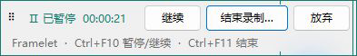
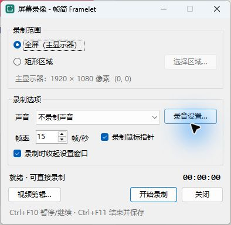

<p align="center">
  
</p>

<h1 align="center">帧简 Framelet</h1>

<p align="center">
  <strong>让画面，表达得更简单。</strong><br>
  Windows 截图、标注与录屏工具 · Capture. Annotate. Share.
</p>

<p align="center">
  <a href="https://github.com/chenzhiyong1994/Framelet/releases/latest"></a>
  
  <a href="LICENSE"></a>
</p>

<p align="center">
  <a href="https://github.com/chenzhiyong1994/Framelet/releases/latest"><strong>下载便携版</strong></a>
  &nbsp; · &nbsp;
  <a href="https://chenzhiyong1994.github.io/Framelet/">项目主页</a>
  &nbsp; · &nbsp;
  <a href="docs/usage.md">使用指南</a>
  &nbsp; · &nbsp;
  <a href="docs/features.md">功能说明</a>
</p>

<br>


<p align="center"><sub>截取一个画面，加上清楚的标注，复制或保存。需要演示时，再录一段屏幕。</sub></p>

## 三件日常小事，顺手完成

| 截取画面 | 说明重点 | 录下过程 |
| :--- | :--- | :--- |
| 区域、窗口、全屏截图，快捷键随时唤起。紧凑浮窗贴边自动收起。 | 箭头、文字、序号、高亮与马赛克；裁剪、调整尺寸后复制或保存。 | 全屏或区域录制，倒计时、计时与控制条清晰可见。暂停、继续，保存 MP4。 |

**无声录屏开箱即用。** 使用 Windows 原生媒体能力，无需安装 FFmpeg、无需选择工具路径。录音与视频首尾剪辑是可选扩展，才需要另行配置 FFmpeg。

## 开始使用

1. 在 [Releases](https://github.com/chenzhiyong1994/Framelet/releases/latest) 下载 Windows x64 ZIP 便携包。
2. 解压后打开 `Framelet.exe`；包内包含 .NET 运行时，无需另装 .NET。
3. 按 `Ctrl+PrtSc` 截取区域，或点击浮窗上的录像图标开始录屏。

截图和标注默认保持 **实际大小 · 100%**。大图可滚动浏览，也能手动切换“适合窗口”。Windows 需具备媒体组件，缺少媒体功能的系统版本需先补齐对应组件。

<table>
  <tr>
    <td width="52%" valign="top">
      <h3>小浮窗，随时在手边</h3>
      <p>常用入口集中在一行。拖到屏幕边缘后自动收为小图标，悬停或点击展开。</p>
      
      <h3>录制中，也能从容控制</h3>
      <p>计时、暂停与结束常驻。暂停后可继续、保存或丢弃；取消保存也能接着录。</p>
      
    </td>
    <td width="48%" valign="top">
      <h3>范围与选项，一眼看清</h3>
      <p>选区支持拖动与四角调整。确认后，3 秒倒计时为演示留出准备时间。</p>
      
    </td>
  </tr>
</table>

## 常用快捷键

| 操作 | 默认快捷键 |
| :--- | :--- |
| 截取矩形区域 | `Ctrl+PrtSc` |
| 截取活动窗口 / 全屏 | `Alt+PrtSc` / `PrtSc` |
| 显示工具栏 | `Ctrl+Shift+F12` |
| 打开录像机 | `Ctrl+Shift+F9` |
| 录像暂停 / 继续 | `Ctrl+F10` |
| 结束录像 | `Ctrl+F11` |

截图快捷键冲突时可在设置中切换数字组合；录屏快捷键冲突时可使用控制条按钮。[全部快捷键与长截图用法 →](docs/usage.md#快捷键)

## 产品范围

Framelet 聚焦日常截图、像素标注、本地输出与基础录屏。支持 PNG、JPEG、BMP、GIF、TIFF 和单页 PDF 导出；GIF/TIFF 只编辑首帧或首页，标注提交为像素并支持会话内撤销。

长截图采用手动滚动采集；录音需要可选 FFmpeg，真实音频录制尚未验证。当前不包含专用扬声器回环、摄像头叠加、Office/FTP 集成、扫描仪、复杂视频特效或完整矢量对象编辑。真实混合 DPI 多屏仍需现场验证。

[查看完整功能边界](docs/features.md) · [查看已完成的验证与限制](docs/validation.md)

## 从源码构建与验证

使用 Windows 与 .NET SDK **10.0.401**（版本约束见 `global.json`），在仓库根目录运行：

```powershell
# 构建便携版；输出目录需为空
./scripts/build.ps1 -Publish

# 图像、配置、原生 MP4 编码及捕捉/拼接检查
./scripts/test.ps1
```

SDK 不在 `PATH` 中时可传入 `-DotnetPath '<SDK>/dotnet.exe'`。完整构建参数、可选 FFmpeg 检查、命令行入口与诊断日志见 [开发与诊断](docs/development.md)。

## 文档与参与

[使用指南](docs/usage.md) · [功能说明](docs/features.md) · [开发与诊断](docs/development.md) · [验证记录](docs/validation.md) · [品牌规范](docs/brand.md)

遇到问题或有改进建议，欢迎提交 [Issue](https://github.com/chenzhiyong1994/Framelet/issues)。描述操作步骤、系统与显示缩放，附上便于复现的截图即可。

## 许可

采用 [MIT License](LICENSE)。便携包中的 .NET 运行时与可选 FFmpeg 的说明见 [第三方组件说明](THIRD-PARTY-NOTICES.md)。
