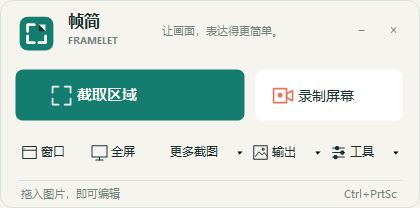
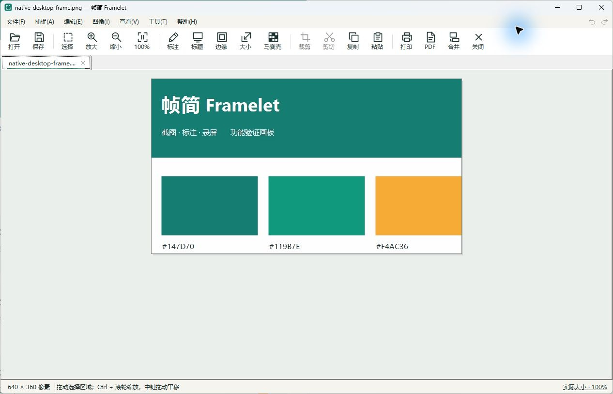

# 帧简 Framelet 0.2.1

**让画面，表达得更简单。** 帧简 Framelet 是面向日常高频场景的 Windows 截图、标注与录屏工具。截图、画箭头、遮住敏感信息，随后复制或保存；需要演示时，录制一段屏幕并裁掉首尾。

[下载 Windows x64 便携版](https://github.com/chenzhiyong1994/Framelet/releases/latest) · [从源码构建](#从源码构建与验证) · [功能边界](docs/features.md)





## 产品范围

主要功能：

- 截取区域、窗口或全屏，支持快捷键唤起和取消。
- 添加箭头、文字、序号、高亮与马赛克，完成裁剪、尺寸调整和撤销/重做。
- 复制图像用于粘贴，或保存为常用图片格式；保存失败时保留原文件和当前编辑。
- 录制屏幕或指定区域，暂停/继续、保存 MP4，并裁掉视频首尾。

当前聚焦常用操作的步骤、响应速度、稳定性和清晰反馈。Office/FTP 集成、扫描仪、复杂视频特效及完整矢量对象编辑不属于当前产品范围。实现状态与已验证范围分别见[功能说明](docs/features.md)和[验证记录](docs/validation.md)。

## 直接运行

从 [Releases](https://github.com/chenzhiyong1994/Framelet/releases/latest) 下载并解压 Windows x64 便携包，打开 `Framelet.exe`。发布包包含 .NET 运行时，无需另装 .NET；录屏和视频剪辑需要外部 FFmpeg。

- 主面板点击“截取区域”快速截图；窗口、全屏入口常驻，“更多截图”收纳手绘、长截图、固定区域与重复截图。截图可送到编辑器、剪贴板、文件或打印机。
- 在编辑器中裁剪、缩放、旋转、调整亮度、添加边缘和标题，或进入绘图添加箭头、文字、序号、高亮、马赛克等。支持多标签、撤销/重做和图像合并。
- 点击“录制屏幕”录制主显示器或矩形区域；结束后保存 MP4/WMV。录像机的“视频剪辑…”可预览并裁剪现有视频，也可转换输出格式。
- “工具”菜单提供取色器、放大镜、标尺、聚光灯、十字线及定时自动截图。点击工具栏 `−` 收起，双击通知区域图标恢复。

图像支持 PNG、JPEG、BMP、GIF、TIFF；GIF/TIFF 以首帧/首页静态图像编辑。PDF 仅支持单页栅格导出。绘图提交为像素，保留会话内撤销，不保留可再次选中的矢量对象。

## 快捷键

| 操作 | 默认快捷键 |
| --- | --- |
| 活动窗口 | `Alt+PrtSc` |
| 窗口/对象 | `Shift+PrtSc` |
| 矩形区域 | `Ctrl+PrtSc` |
| 手绘区域 | `Ctrl+Shift+PrtSc` |
| 全屏 | `PrtSc` |
| 长截图 | `Ctrl+Alt+PrtSc` |
| 固定区域 | `Ctrl+Alt+Shift+PrtSc` |
| 显示工具栏 | `Ctrl+Shift+F12` |
| 打开录像机 | `Ctrl+Shift+F9` |
| 录像暂停/继续 | `Ctrl+F10` |
| 结束录像 | `Ctrl+F11` |

截图快捷键被占用时，可在“设置 → 快捷键”切换为 `Ctrl+Shift+1–7`，对应上表前七项。录屏快捷键仅在录制期间注册，冲突时使用窗口按钮。

长截图需要手动操作：先选纯滚动内容区域，再向下滚动并按 `F8` 采集，按 `F9` 完成；每屏至少保留约四分之一重叠。单次最多 50 屏，并受总像素内存限制。适合静态内容，不支持自动滚动或固定标题栏消除；无法可靠匹配时会保留完整帧，可能出现重复区域。

## FFmpeg 与声音

录像机中的“选择 FFmpeg…”可指定 `ffmpeg.exe`，也可以设置 `FRAMELET_FFMPEG`。未显式配置时，程序依次检查程序目录、`PATH` 和当前用户的 WinGet FFmpeg 安装目录。显式配置失效时会报错，不自动切换到其他版本。视频信息优先通过同目录的 `ffprobe.exe` 读取。

已确认 FFmpeg 8.1.1 提供 `gdigrab`；`libx264`、`wmv2` 的真实编码与视频剪辑已通过合成画面自检。其他安装需要包含这些组件。真实桌面录像的验证范围见验证记录。FFmpeg 不随本项目发布包分发。

声音默认关闭，可选择本机 DirectShow 音频设备。目前仅验证设备发现，未实际录音；没有实现专用的扬声器回环采集或摄像头叠加。录像异常时会提示保留片段的位置；取消保存对话框后录像保持暂停，可继续录制或再次保存。

## 从源码构建与验证

主项目为 `src/Framelet/Framelet.csproj`，`global.json` 指定 .NET SDK `10.0.401`，允许同功能带的补丁升级。在仓库根目录运行：

```powershell
# 构建并生成 dist/Framelet/Framelet.exe
./scripts/build.ps1 -DotnetPath '<SDK>/dotnet.exe' -Publish

# 已有发布文件时，选择新的空目录
./scripts/build.ps1 -DotnetPath '<SDK>/dotnet.exe' -Publish -PublishDirectory dist/Framelet-0.2.1

# 图像、配置、格式和捕捉/拼接检查
./scripts/test.ps1 -DotnetPath '<SDK>/dotnet.exe'

# 额外执行真实 FFmpeg 编码、暂停恢复、合并与裁剪检查
./scripts/test.ps1 -DotnetPath '<SDK>/dotnet.exe' -WithRecording
```

SDK 已在 `PATH` 中时可以省略 `-DotnetPath`，也可以设置 `DOTNET_EXE`。发布目录必须为空，脚本会复制当前 README、文档、品牌素材及运行时许可；已有文件时用 `-PublishDirectory` 选择新目录，避免旧文件混入。录屏自检使用合成画面，不采集桌面或麦克风。应用自检报告写入 `artifacts/self-tests/results.json`；这些检查不等同于所有桌面交互都已验证，人工验证记录见 [验证说明](docs/validation.md)。

支持的命令行入口：

| 参数 | 用途 |
| --- | --- |
| `图片路径` | 在编辑器打开图片 |
| `--editor` | 打开空白图像编辑器 |
| `--recorder` | 打开录像机 |
| `--profile 配置路径` | 指定主应用配置文件；录屏选项仍使用用户级配置 |
| `--fixture` | 打开供人工捕捉验证使用的样例窗口 |
| `--self-test` | 运行应用自检后退出 |
| `--output 输出目录` | 指定自检产物目录，与 `--self-test` 配合 |
| `--with-recording` | 在应用自检中增加 FFmpeg 编码与裁剪检查 |

品牌色、标志和界面原则见 [品牌说明](docs/brand.md)。默认将截图存入图片目录的 Framelet 文件夹。

## 配置与诊断

0.2.1 使用统一的 Framelet 配置入口：主应用配置为 `%LOCALAPPDATA%\Framelet\settings.json`，录屏配置为同目录的 `recorder.json`。首次使用此目录时采用默认设置，可在“设置”中调整快捷键与输出目录，并在录像机中重新选择 FFmpeg。程序仅使用当前品牌的目录与环境变量，不自动导入其他位置的配置。

设置 `FRAMELET_TRACE=1` 可启用诊断日志，日志保存在主应用配置所在目录的 `diagnostics.log`。设置 `FRAMELET_FFMPEG` 可指定 FFmpeg 可执行文件；`--profile` 可为主应用指定独立配置文件。

## 许可

本项目采用 [MIT License](LICENSE)。便携包中的 .NET 运行时与外部 FFmpeg 的说明见 [第三方组件说明](THIRD-PARTY-NOTICES.md)。
